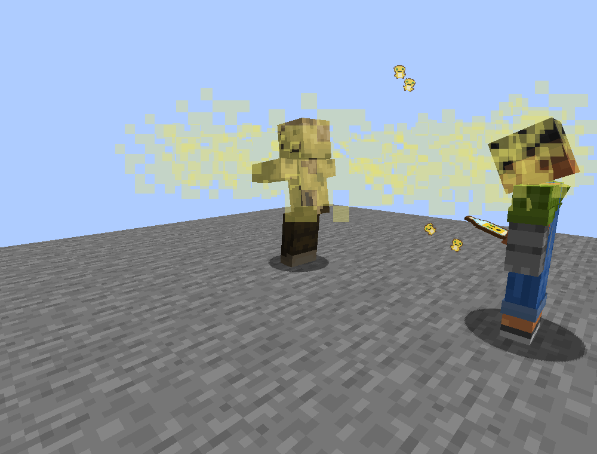
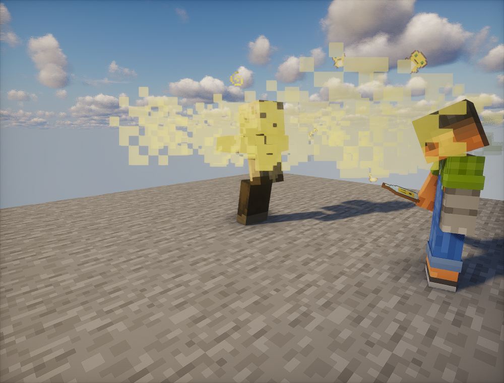

# 0.4.9 验证范围

2026-11-07，Minecraft Java 1.21.1 / NeoForge 21.1.252 / Java 21。

## v0.4.9 正式包源码快照

本节对应 `v0.4.9` 标签和发布附件。后续主分支纳入多加载器适配，构建入口见[奶蛙多加载器构建](../ports/README.md)。

当前生产源码、测试、模型和运行资源由开发项目同步，模型及生产素材按原字节保留。独立上传目录执行 `scripts/gradle.ps1 build qaJar runGameTestServer --offline --console=plain`，构建、模型与粒子参数检查、QA编译及108项必需GameTest通过。复用Windows本机依赖缓存，不读取原开发源；原始本机日志不随源码提交。

独立产物与已验证正式成品SHA256一致：

```text
954299b56794da14e46bed20aceb026397c786fd04f66298caa68f683cca6fa3  naiwa-0.4.9.jar
```

成品5,510,480字节。不同源码副本的构建脚本只在Node查找、JDK入口和Blockbench显式路径上做可移植性处理；普通构建不需要编辑器或原始参考媒体。源码中的模型和元数据可重新验证。

对实际Git索引树另外导出不含.git与本机数据的隔离快照，执行build通过；隔离产物仍为上述SHA256，确认换行属性没有改变生产资源或模型字节。

## 开发阶段真实客户端

| 版本 | 已完成覆盖 |
| --- | --- |
| 0.4.5 | 38骨同步模型、六张贴图、11段动画、8.25秒大笑片段和9.65秒完整演出；音轨与动作同步检查 |
| 0.4.7 | 原版与Photon双客户端四次真实飞升、24组手部隐藏／恢复、GPU深度状态、窗口缩放及自有FBO释放重建，76张原图 |
| 0.4.8 | 108项GameTest；六组望远镜窗口／FOV／俯仰双客户端，以及四种整蛊各一次成功／中止，186张原图；包括真实钻石数量与返还核验 |
| 0.4.9 | 原版与Photon各两次真实碰撞（墙面和尸壳），共八组客户端粒子生命周期检查，24张原图 |

0.4.9两端均在实际粒子引擎中观察到36团烟雾和4枚表情、100tick寿命、烟雾长大至约0.42半边长、透明度达到0.38，五秒后数量归零。客户端真实使用瓶子，经TCP创建投掷物，服务端确认每次只消耗一瓶；生物命中同时保持原有控场。Photon实际启用Iris 1.8.14-beta.1、Sodium 0.8.13及低配photon-voxy-support.zip，无错误或回退。

以下是原始GPU截图，未合成或修改；完整实例、其余原图和音频会话静音记录保留在原开发项目，不上传运行库、存档或本机日志。





## 边界

源码独立验证限Windows及已缓存依赖；Linux/macOS、空白缓存首次联网和Blockbench重新采样未验证。0.4.9客户端专项限近距离正常粒子设置及上述Photon；其他光影、减少／最少粒子、远距离传播、高频投掷压力、公网与更多模组组合未测。音频会话静音，不声称做过主观听感评审。历史版本客户端结果不能替代当前所有玩法全流程复测。

网易内置粒子图集未随参考包提供，Java烟雾引用原版generic_7；表情与镜内图片保留用户提供字节，不声称不同引擎像素完全一致。来源和权利边界见[来源说明](../THIRD_PARTY_NOTICES.md)。
