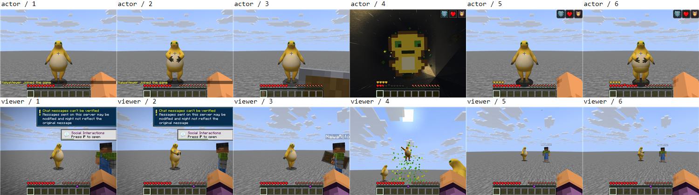
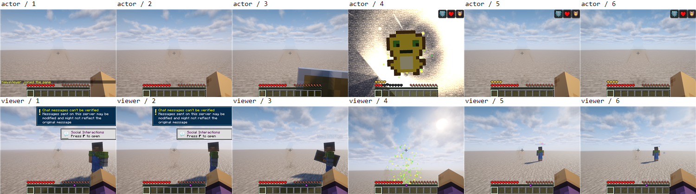
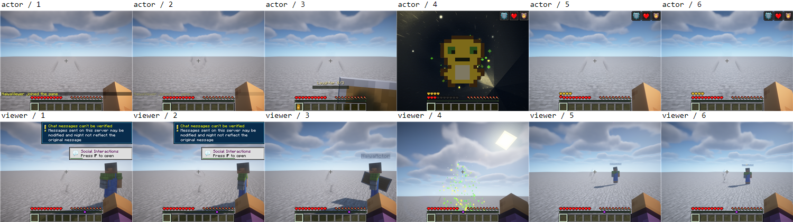
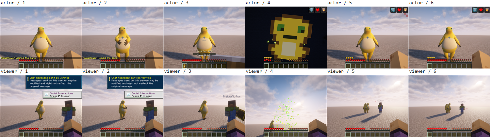

# 奶蛙 0.5.1 五端客户端、联机与光影验证

2026-11-11 至 12 日对已发布的五个移植端原包补测，共 15 个组合、17 次有效尝试。源码基线为 729e631198a47617a9a6fce8ec497afd587d9807，标签 v0.5.1。六个正式 JAR 的 SHA256 在测试前后与发布清单一致，未修改游戏代码、资源、安装包或许可。

| 端口 | 无光影 | Unbound r5.8.1 | BSL v10.1.3 + Clrwl 1.0.5 |
| --- | --- | --- | --- |
| Fabric 1.21.1 | 通过 | 通过 | 通过 |
| Fabric 1.20.1 | 专服崩溃，阻断 | 专服崩溃，阻断 | 专服崩溃，阻断 |
| Forge 1.20.1 | 飞升时双端崩溃 | 通过 | 登录超时，未完成 |
| NeoForge 26.1.2 | 通过 | 奶蛙模型不可见 | 奶蛙模型不可见 |
| Fabric 26.1.2 | 复测通过，首轮转盾超时 | 奶蛙模型不可见 | 奶蛙模型不可见 |

“通过”表示独立专服、两个真实客户端完成模型显示、空手交互大笑同步、普通盾转化、图腾真实致死保护与飞升、落地存活、资源重载六个阶段，并核对截图和正常退出。通过范围只包含这些路径。自动状态断言完成的四个 26.1.2 光影场景，经截图复核模型缺失，最终列为失败。共 6 次完整验收通过、11 次失败或阻断；截图 130 张，逐张摘要见[验证汇总](0.5.1-ports-summary.json)。

## 失败与复测

- **Fabric 1.20.1**：三种配置均在玩家入服后的整蛊检查中发生服务端空指针异常。NaiwaPranks.startCreeper → NaiwaGameplay.clearLine:100 → EntityCollisionContext；旧版 ClipContext 收到空实体。完整双端与光影验收被服务端崩溃阻断，不能据此判定为光影不兼容。现有端口 GameTest 未覆盖这一条路径。
- **Forge 1.20.1 无光影**：模型、大笑和转盾完成；图腾飞升时两端均在 NaiwaModel.drawFlight → draw:142 → BufferBuilder.endVertex 崩溃，异常为 Not filled all elements of the vertex。Oculus + Unbound 完成了相同流程，不能把此结果推广到无光影配置。
- **26.1.2 NeoForge／Fabric 光影**：Unbound 与 BSL 下两端状态同步、转盾和飞升断言完成，普通奶蛙及飞升画面中的模型主体不可见；无光影画面正常。两种加载器、两款光影均保留原图，原因尚未定位。颜色阈值会被背景及 HUD 满足，不能代替模型画面审查。
- **Fabric 26.1.2 无光影**：首轮大笑同步完成后，服务端确认主手替换为普通盾，但两端在转盾阶段超时；独立新实例复测完成全部六阶段并正常退出。首轮现场保留，原因未明，不声明该偶发问题已修复。
- **Forge 1.20.1 BSL**：首轮第二客户端、复测第一客户端在登录期间断开；两轮均未进入完整双端阶段。未见上述飞升崩溃的触发证据，暂列登录阻断，不能宣称 BSL 验证通过或将断开归因为奶蛙。

## 环境与依赖

Windows、NVIDIA GeForce RTX 3060 Laptop GPU、1000×760、视距 4；JDK 17／21／25 与发布安装要求一致。客户端均隐藏运行、静音、无焦点、不捕获桌面鼠标；离线测试账号连接只监听 127.0.0.1 的独立专服。服务端仅含正式奶蛙和必要的 Fabric API，客户端额外加载独立 QA 模组，正式 JAR 不含探针。

| 端口 | 光影客户端依赖 |
| --- | --- |
| Fabric 1.21.1 | Iris 1.8.14-beta.1 + Sodium 0.8.13 |
| Fabric 1.20.1 | Iris 1.7.6 + Sodium 0.5.12-beta.2 |
| Forge 1.20.1 | Oculus 1.8.0 + Embeddium 0.3.31 |
| NeoForge／Fabric 26.1.2 | Iris 1.11.4 + Sodium 0.9.2，分别使用对应加载器构建 |

依赖来自 Modrinth 官方项目，下载时核对发布方 SHA512。本轮使用 Complementary Unbound r5.8.1 和 BSL v10.1.3 + Clrwl 1.0.5，每阶段核对 Iris／Oculus 接口返回的启用状态。不会用仅安装光影模组代替已开启光影。

## 截图对照

每张上行为操作者、下行为旁观者，从左到右为模型、大笑、转盾、飞升、落地、重载。飞升时操作者画面包含原版图腾覆盖层；夜景和雨幕按既有规则只显示给触发者。

本轮未验证公网／局域网跨设备、Linux／macOS、声音听感、长期存档、十种整蛊全部分支、三次盾牌格挡释放、笑气投掷和望远镜。1.21.1 NeoForge 主端仍沿用原候选字节一致的既有证据，未重复启动。本轮为验证记录更新，发现的问题尚未修复。
