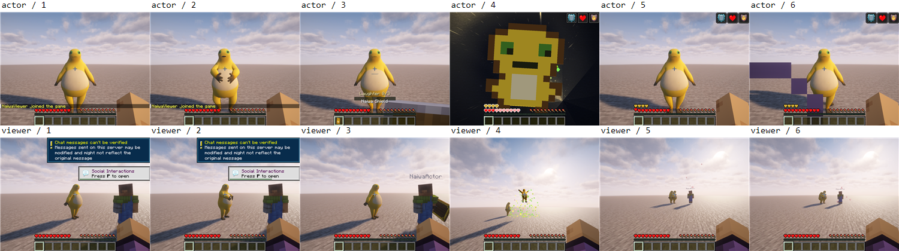
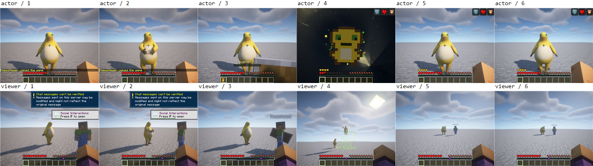

# 奶蛙 0.5.2 验证记录

## 修复与构建

0.5.2 修复 1.20.1 的射线碰撞上下文、飞升顶点写入和着色器属性声明，改用 Forge 世界实体阶段保存的视图矩阵，并为 26.1.2 的自定义模型登记 Iris 管线。Forge 1.20.1 的协议切换和发包在连接事件循环内串行执行，避免连接活动但未订阅读事件时发生状态探测或登录超时。网络读超时保持原版 30 秒。

六端从独立源码目录在 Windows 上离线构建，使用 JDK 17／21／25、Node.js 22.23.3 和已有 Gradle 缓存，模型检查及 127 项必需服务端 GameTest 通过。命令与工具链见[六端构建说明](../ports/README.md)。

| Minecraft | 加载器 | 必需 GameTest |
| --- | --- | ---: |
| 1.20.1 | Forge 47.4.23 | 4 |
| 1.20.1 | Fabric Loader 0.19.4 | 4 |
| 1.21.1 | NeoForge 21.1.252 | 108 |
| 1.21.1 | Fabric Loader 0.19.4 | 3 |
| 26.1.2 | NeoForge 26.1.2.94 | 4 |
| 26.1.2 | Fabric Loader 0.19.4 | 4 |

## 客户端、联机与光影

五个移植端的修复候选完成以下矩阵，共 15 组。每组使用一台独立回环专服和两名真实 GPU 客户端，覆盖普通模型、空手大笑同步、盾牌转化、真实致死伤害触发图腾飞升、存活落地及资源重载。自动状态断言、模型画面复核和三个进程正常退出均通过，180 张阶段截图留档。测试使用 Windows、RTX 3060 Laptop GPU、1000×760 窗口；客户端隐藏、静音且不捕获鼠标。

| 目标 | 无光影 | Unbound r5.8.1 | BSL v10.1.3 + Clrwl 1.0.5 |
| --- | --- | --- | --- |
| Forge 1.20.1 | PASS | PASS | PASS |
| Fabric 1.20.1 | PASS | PASS | PASS |
| Fabric 1.21.1 | PASS | PASS | PASS |
| NeoForge 26.1.2 | PASS | PASS | PASS |
| Fabric 26.1.2 | PASS | PASS | PASS |

这组画面来自版本字段为 0.5.1 的修复候选。五个 0.5.2 移植包均从源码重新构建，解包比较确认代码与生产资源原字节一致，版本元数据更新为 0.5.2。Forge 正式包还移除了候选中一份仅供独立验收探针使用的引用映射，生产 Mixin 配置未引用它。上述客户端证据据此关联到 0.5.2。1.21.1 NeoForge 主端本轮完成构建及 108 项服务端测试，未重新运行客户端、联机或光影；此前画面范围见 [0.5.1 记录](0.5.1.md)。

下图上排为操作者、下排为旁观者，六列依次对应上述六个阶段。操作者的图腾弹出层会遮住部分飞升画面，旁观者画面用于确认变身模型。

## 连接回归与覆盖边界

Forge 修复候选在隐藏模式下额外完成两端各 20/20 次新建状态连接，随后完成六个功能阶段并正常退出；没有延长读超时或失败重连。修复前的可见、不抢焦点对照也发生过状态超时，隐藏窗口不是该故障出现的必要条件。

本轮覆盖 Windows 本机专服双客户端。公网、跨设备、长期存档、声音听感、十种整蛊全部分支、空缓存首次构建及 Linux／macOS 尚未验收。
