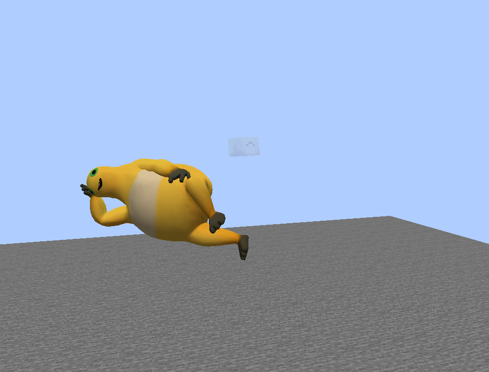

# 奶蛙 0.5.3 验证记录

## 模型与飞行联动

模型包含 40 根骨骼、4,685 个顶点、9,207 个三角面、六张贴图和 13 段动画。运行资源通过源文件摘要、原生姿势对照、动作衔接和蒙皮检查。四方向检查验证侧躺头部朝向实体水平前方，起落姿态在半秒内平滑过渡。

Minecraft 1.21.1 NeoForge 在无光影环境下完成双客户端联动测试：真实音乐抽选、三档飞行、停止播放后落地、重力恢复均通过。表情另完成六角度近景检查。飞行姿态示例：

## 构建与服务端

独立源码目录六端构建及 127 项必需服务端 GameTest 通过：NeoForge 1.21.1 为 108 项，Forge 1.20.1、Fabric 1.20.1、NeoForge 26.1.2、Fabric 26.1.2 各 4 项，Fabric 1.21.1 为 3 项。主端另通过模型、飞行朝向和动作衔接检查。

## 未覆盖范围

本轮未复测五个移植端的客户端、联机与光影，未验证主端光影、公网跨设备、长期存档及完整玩法。0.5.2 的历史兼容性结果见[原记录](0.5.2.md)，不作为本次新增飞行动作的验收结论。

独立构建使用 Windows、JDK 17／21／25、Node.js，复用现有 Gradle 缓存；未验证空缓存首次联网或 Linux／macOS。
